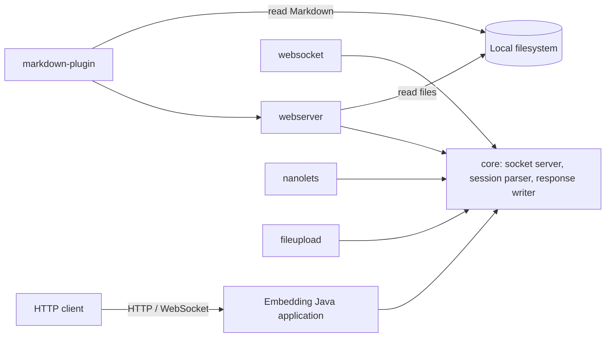

# Architecture Overview

## System shape

NanoHTTPD is a Java library embedded in a host application. The library accepts HTTP connections and delegates each parsed request to a handler. Optional modules add WebSocket, static-file serving, URI routing, multipart upload, Markdown rendering, and examples. 🟢 **CONFIRMED** by the root build modules and source dependencies.

## Runtime architecture

- **Core:** server socket lifecycle, client handlers, HTTP session parsing, extension handlers/interceptors, response serialization, socket/thread strategies, and temporary-file services.
- **WebSocket:** intercepts HTTP upgrade requests, then processes frames on the upgraded connection.
- **Webserver:** serves files under configured local roots; optionally delegates MIME types to plugins.
- **Nanolets:** maps URI patterns to handler classes and method callbacks.
- **File upload:** adapts session streams and headers to Apache Commons FileUpload.
- **Markdown plugin:** renders Markdown files using Pegdown and the webserver plugin interface.
- **Samples:** runnable demonstration applications.
- **Relocation:** Maven metadata for old artifact coordinates; it is not a runtime module in the root build.

All modules run in the embedding application's JVM; no separately deployed services, database, queue, or cache were found. 🟢 **CONFIRMED** from module dependencies and repository inventory.

## Integrations and boundaries

| Integration | Direction | Protocol / format | Scope |
|---|---|---|---|
| HTTP clients | Inbound | HTTP/1.x over TCP; optional TLS socket factory | Runtime |
| WebSocket clients | Inbound after HTTP upgrade | WebSocket frames | Optional runtime module |
| Local filesystem | Read/write | Java file and stream APIs | Webserver and request temp-file implementations |
| Apache Commons FileUpload | In-process library | Multipart request stream adapter | Optional runtime module |
| Pegdown | In-process library | Markdown text to HTML | Optional runtime module |
| Apache HttpComponents, Jetty WebSocket client, Mockito, JUnit | Test-only | Test clients/frameworks | Build/test scope |

No outbound production REST/GraphQL API, webhook, message broker, or database integration was found. 🟢 **CONFIRMED** in inspected source and build manifests.

## Technical debt and risks

- Maven and Gradle configurations duplicate module and dependency declarations; several test dependency versions differ by module.
- The checked-out snapshot configures Java 7 and uses older build plugin versions. This is a repository fact; current support status is not established by the snapshot.
- Graphify partially parsed eight Gradle descriptors and indexed local agent/Reversa tooling along with product sources. Module boundaries were cross-checked against build files; graph-wide counts and communities are not a clean product-only measurement.
- Security policy for request/upload/frame size limits, directory-listing HTML, sample HTML interpolation, and Markdown output sanitization is not specified. See `questions.md`.

## Confidence

- 🟢 **CONFIRMED:** single-process embeddable library with optional modules; no persistence system or external runtime service integration in the inspected source.
- 🟡 **INFERRED:** intended host is a Java application that supplies application-specific handlers and access control.
- 🔴 **GAP:** production deployment topology and hardening policy are not represented by Docker/cloud configuration in this repository.
