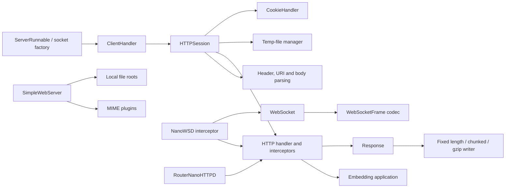

# C4: Core Components

Responsibilities are drawn from the module and class contracts. The AST graph identifies `NanoHTTPD`, `IHTTPSession`, `Response`, and `WebSocketFrame` as highly connected abstractions, but graph centrality is treated as a navigation signal because the graph also includes local tooling.
