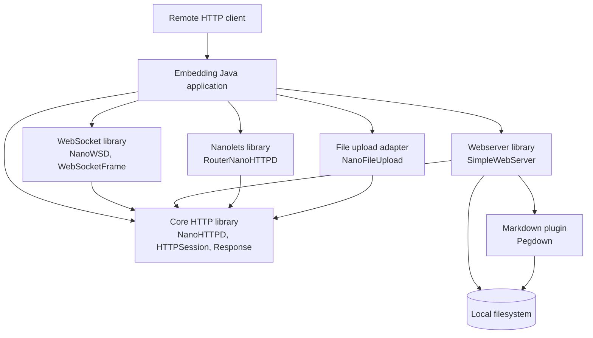

# C4: Containers / Runtime Units

The repository builds library artifacts that are loaded into one host JVM. The boxes below are logical runtime units, not independently deployed processes.

Build tooling includes Maven and Gradle. No database, queue, cache, container image, or separately deployed backend was found. 🟢 **CONFIRMED**.
