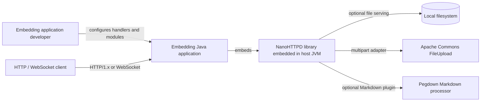

# C4: System Context

**System purpose:** provide an embeddable HTTP server and optional protocol/server extensions. The Java host supplies routes, response logic, and application authorization. External libraries are in-process dependencies, not remote services. 🟢 **CONFIRMED** for code/build relationships; host responsibilities are 🟡 **INFERRED** from the handler API.
