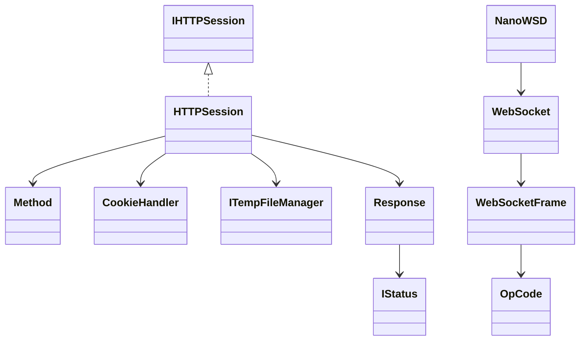

# Data Model / ERD

## Persistence finding

No relational schema, database migrations, ORM models, or persistent business entities were found. A database ERD therefore does not apply to this repository snapshot. 🟢 **CONFIRMED** from the source inventory and Scout schema search.

The classes below are transient request/response structures, not database entities:

Field-level details are in `data-dictionary.md`.
