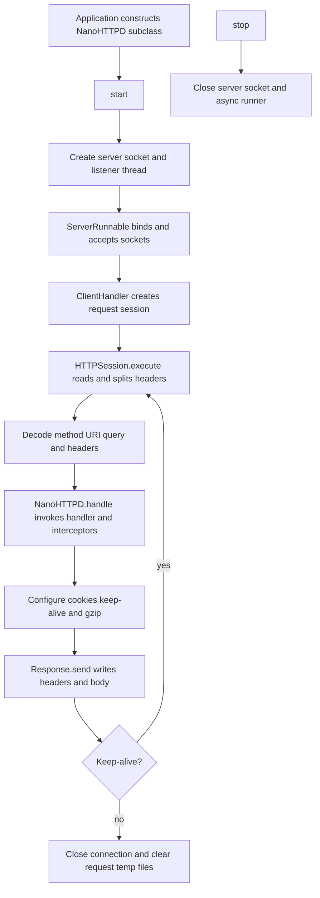

# Core HTTP Server Flow

The request loop is owned by the connection handler; `HTTPSession.execute()` handles one request and the runner can continue for persistent connections. Socket and timeout exceptions propagate to close the connection. Other I/O and protocol parse errors are converted to an error response and the stream is closed. Evidence: `NanoHTTPD.java:579-637`, `HTTPSession.java:338-465`.
