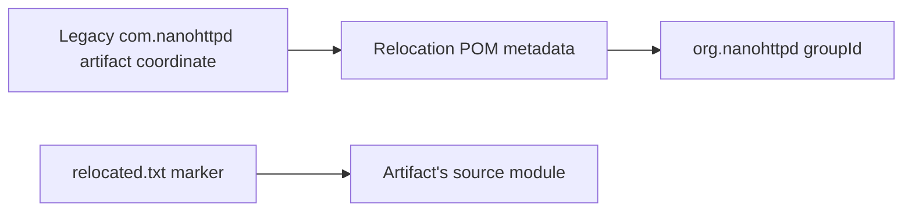

# Relocation Artifact Flow

The relocation tree contains Maven POM metadata and marker resources; no Java source is present in these directories. Evidence: `relocation/pom.xml` and the five child POM/resource pairs.
