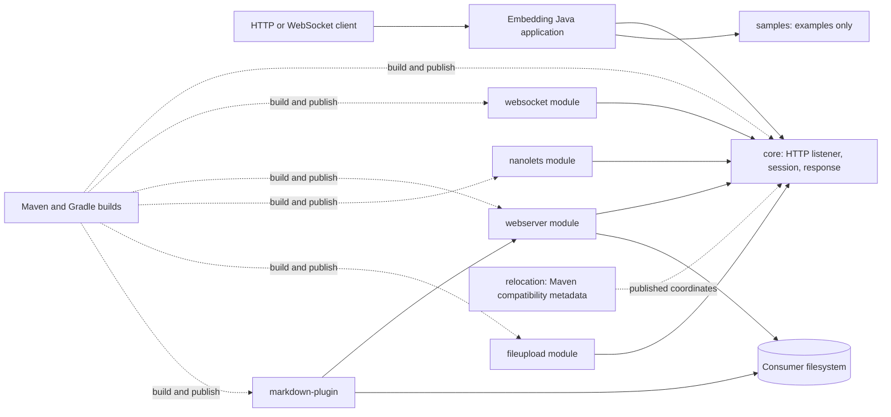

# Target Architecture

> Architecture for the user-selected Big Bang release, preserving the legacy module topology and framework-neutral Java design.

## Overview
NanoHTTPD remains an embeddable Java library whose host application owns request business logic and deployment. Preserve the existing `core`, `websocket`, `webserver`, `nanolets`, `fileupload`, `markdown-plugin`, `samples`, and `relocation` module boundaries. The runtime remains in one JVM with optional extensions, no database, no message broker, and no service deployment. A coordinated major release updates dependencies against the maintainer-confirmed Java 17 minimum.

## Diagram



## Components

| Component | Type | Responsibility | Origin |
|---|---|---|---|
| `core` | Library module / protocol API | Socket lifecycle, request parsing, session and handler contracts, response serialization, temporary request storage | `_reversa_sdd/core/requirements.md` |
| `websocket` | Optional library module | HTTP upgrade, frame encoding/decoding, callbacks, ping/pong and close lifecycle | `_reversa_sdd/websocket/requirements.md` |
| `webserver` | Optional library module | Static file and directory responses, ranges, ETags, plugins and configured CORS | `_reversa_sdd/webserver/requirements.md` |
| `markdown-plugin` | Optional plugin module | Convert Markdown resources to UTF-8 HTML through the webserver plugin interface | `_reversa_sdd/markdown-plugin/requirements.md` |
| `nanolets` | Optional library module | URI route matching and method callback dispatch | `_reversa_sdd/nanolets/requirements.md` |
| `fileupload` | Optional adapter module | Adapt session streams and headers to Apache Commons FileUpload | `_reversa_sdd/fileupload/requirements.md` |
| `samples` | Example applications | Demonstrate server startup, request inspection, and temporary-file management | `_reversa_sdd/samples/requirements.md` |
| `relocation` | Compatibility packaging | Publish Maven relocation metadata and markers for old coordinates | `_reversa_sdd/relocation/requirements.md` |
| Maven and Gradle descriptors | Build/release tooling | Build and publish equivalent module artifacts with consistent dependency policy | `_reversa_sdd/dependencies.md` |
| Embedding host | External application | Supplies handlers, deployment configuration, authentication, and business logic | `_reversa_sdd/domain.md` § Scope and inferred rules |

## Bounded contexts

### BC-01: Connection and Protocol Lifecycle
- **Responsibility**: Accept connections, parse HTTP requests, dispatch handlers, serialize responses, and support WebSocket upgrade/frame lifecycle.
- **Grouping justification**: HTTP sessions and WebSocket upgrades share the connection lifecycle and core stream boundary; this is a cohesive protocol context, not a one-to-one copy of the `core` folder.
- **Components**: `core`, `websocket`.
- **Events published/consumed**: None; direct method/callback flow is retained.

### BC-02: Resource Resolution and Rendering
- **Responsibility**: Resolve local resources and produce file, directory, or Markdown responses.
- **Grouping justification**: The Markdown module is a plugin of static resource resolution and shares directory/index selection; keeping its dependency optional avoids forcing renderer dependencies on webserver consumers.
- **Components**: `webserver`, `markdown-plugin`.
- **Events published/consumed**: None.

### BC-03: Host Request Extensions
- **Responsibility**: Provide optional host-facing route dispatch and multipart parsing adapters over the core session contract.
- **Grouping justification**: Both capabilities extend host request handling through `IHTTPSession`; they remain separately packaged because routing and multipart parsing have different dependencies and lifecycle rules.
- **Components**: `nanolets`, `fileupload`.
- **Events published/consumed**: None.

Examples and relocation metadata are delivery/support artifacts rather than runtime bounded contexts. Maven/Gradle build logic remains cross-cutting release infrastructure.

## Architecture decisions

### AD-01: Preserve the library and module topology
- **Decision**: Keep current modules and public package/artifact boundaries for this migration unless a separately approved compatibility change is required.
- **Alternatives discarded**: Reorganize by a new capability tree; convert to independently deployed services.
- **Justification**: The user chose preserved topology and a conservative paradigm; Big Bang is the release timing strategy, not an instruction to break every boundary.
- **Traceability**: `topology_decision.md` § User decision; `paradigm_decision.md` § User decision.

### AD-02: Keep extensions optional and host-controlled
- **Decision**: Do not add mandatory application frameworks, databases, queues, or authentication to the core library.
- **Alternatives discarded**: Framework-bound application architecture or service deployment.
- **Justification**: The system is an embeddable library; its host supplies business behavior and deployment.
- **Traceability**: `_reversa_sdd/architecture.md` § System shape; `target_business_rules.md` BR-MIGRATE-014.

### AD-03: Coordinate a single major release with explicit compatibility gates
- **Decision**: Upgrade modules together under the selected Big Bang strategy, but publish a candidate and retain prior stable artifacts for rollback.
- **Alternatives discarded**: Consumer traffic routing or staggered stable module releases.
- **Justification**: Matches the user's strategy choice while containing downstream compatibility risk.
- **Traceability**: `migration_strategy.md` § Decision for the user; `risk_register.md` RISK-001, RISK-002, RISK-007.

## Honor the chosen paradigm

- **Target paradigm**: Framework-neutral, class-based Java; conservative, with no paradigm change.
- **How this architecture honors it**:
  - Preserve the `NanoHTTPD` lifecycle and `IHTTPSession`/handler extension contracts (BR-MIGRATE-001, 002, 014).
  - Keep extension modules class-based and optional; use existing interfaces at host and plugin boundaries rather than introducing a required DI container.
  - Preserve replaceable temporary storage and caller-supplied FileItemFactory seams (BR-MIGRATE-003, 010).

## Honor the chosen topology

The target retains the current module tree and artifact boundaries. Capability groupings above explain design ownership only; they do not imply folder or coordinate renames.

```text
nanohttpd/
├── core/
├── websocket/
├── webserver/
├── nanolets/
├── fileupload/
├── markdown-plugin/
├── samples/
└── relocation/
```

Maven and Gradle remain supported. Dependency/version policy should be aligned across both descriptors without introducing a new build framework unless separately approved.

## Edges with the legacy during migration

There is no runtime traffic edge between old and new service implementations. Consumers opt into versioned library artifacts. The previous stable coordinates remain available during the major release adoption period; rollback means consumers continue using the prior release. `relocation/` policy remains governed by the approved support horizon.

## Notes

The Java 17 minimum is confirmed. Before selecting “latest” dependency versions, check binary compatibility, licenses, transitive vulnerabilities, and Maven/Gradle resolution parity.
