# State Machines

## WebSocket connection

The protocol implementation defines `UNCONNECTED`, `CONNECTING`, `OPEN`, `CLOSING`, and `CLOSED`. The diagram below reflects transitions visible in the code. Some close paths call `doClose()` directly, so the implementation permits termination before the connection reaches OPEN.

```mermaid
stateDiagram-v2
    [*] --> UNCONNECTED
    UNCONNECTED --> CONNECTING: handshake response send begins
    CONNECTING --> OPEN: 101 response written; onOpen called
    OPEN --> CLOSING: local close requested
    OPEN --> CLOSING: peer close received
    CLOSING --> CLOSED: peer confirms / doClose
    UNCONNECTED --> CLOSED: close or setup failure
    CONNECTING --> CLOSED: read/handshake failure
    OPEN --> CLOSED: I/O or protocol failure / doClose
    CLOSED --> [*]
```

Evidence: `websocket/src/main/java/org/nanohttpd/protocols/websockets/WebSocket.java:58-71,119-152,161-175,203-245`; enum in `State.java:36-42`.

| Current state | Trigger | Next state | Confidence |
|---|---|---|---|
| UNCONNECTED | Handshake response send starts | CONNECTING | 🟢 CONFIRMED |
| CONNECTING | Response sent; `onOpen()` invoked | OPEN | 🟢 CONFIRMED |
| OPEN | Local `close()` | CLOSING | 🟢 CONFIRMED |
| OPEN | Peer Close frame | CLOSING, then CLOSED after close handling | 🟢 CONFIRMED |
| Any non-CLOSED state | `doClose()` | CLOSED | 🟢 CONFIRMED |
| OPEN | Read/protocol exception | CLOSED through `doClose()` | 🟢 CONFIRMED |

## Other stateful values

HTTP server startup is represented by socket/thread presence and a listener bind flag, rather than a public server state enum. `NanoHTTPD.wasStarted()` checks for non-null socket and thread; no richer lifecycle transition contract was found. 🟡 **INFERRED** as an implementation detail, not an explicit domain state machine.

No order, account, payment, or other business entity lifecycle was found.
